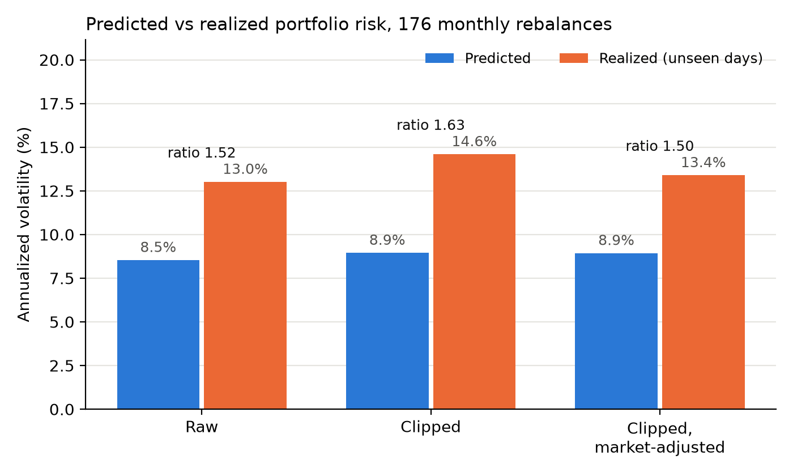

# EIGEN: Cleaning stock correlation matrices with random matrix theory

**Status: v1.0, Phase 1 complete.**

I built a 102 x 102 correlation matrix from 4,205 days of returns for 102 large US stocks (2010 to 2026). The top eigenvalue reached 38.06 out of 102, showing a single broad market factor carries roughly 37% of all stock movement, and exactly eight eigenvalues beat the Marchenko-Pastur noise ceiling of 1.34. I cleaned the matrix by eigenvalue clipping, built minimum-variance portfolios, and tested them on unseen days over 176 monthly rebalances.

**Conclusion: on this data, cleaning does not beat the raw matrix.** Raw had the lowest realized risk (13.01%, vs 14.59% clipped and 13.39% clipped-adjusted). All three matrices also promised too little risk: every realized number came in about 50% higher than predicted.

Full write-up: [RESULTS.md](RESULTS.md)

## Run it yourself

Requires Python 3.14. On Windows:

    git clone https://github.com/HunterPlatania/eigen
    cd eigen
    py -m venv .venv
    .venv\Scripts\Activate.ps1
    pip install -r requirements.txt
    python run_all.py

The data is cached in `returns.parquet`, so no download is needed. A fresh clone reproduces the numbers above exactly.

## Files

| File | What it does |
| :-- | :-- |
| `data.py` | Downloads prices with yfinance and builds `returns.parquet` |
| `spectrum.py` | Correlation matrix, eigenvalues, Marchenko-Pastur curve, market mode removal |
| `clean.py` | Eigenvalue clipping and covariance |
| `portfolio.py` | Minimum-variance portfolios |
| `backtest.py` | Rolling out-of-sample backtest and the headline figure |
| `RESULTS.md` | Full Phase 1 write-up |
| `run_all.py` | Regenerates all three figures and prints the headline ratios |

## Cut from Phase 1

Sector matching (1.4) and the Ledoit-Wolf benchmark (1.8) were cut for time and are planned for later.

## Reference

Laloux, Cizeau, Bouchaud and Potters (1999), "Noise dressing of financial correlation matrices," *Physical Review Letters* 83, 1467.